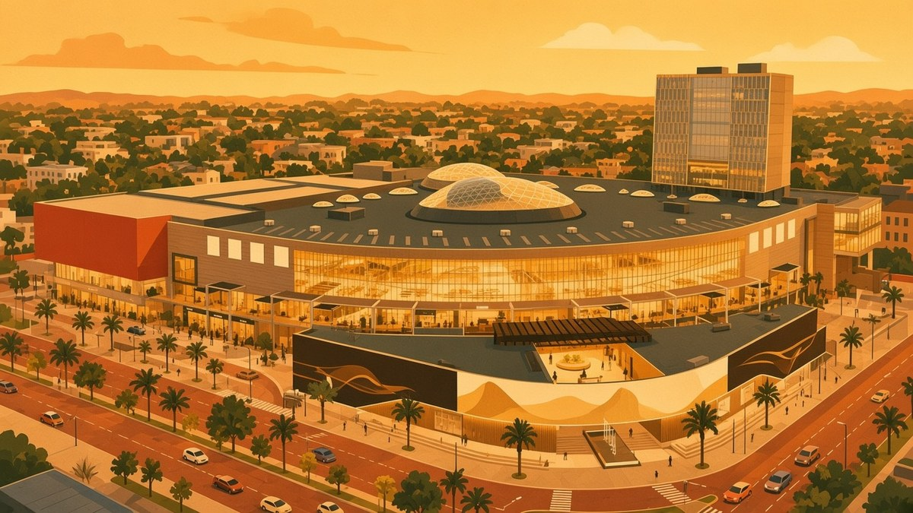

Ventura Sur, el centro comercial nuevo del Grupo Daher, está en el 5to anillo y la Doble vía a La Guardia, todavía en Santa Cruz de la Sierra. El km 12, Urbanización Nueva Esperanza, ya es Municipio de La Guardia: misma avenida, más adelante, unos 8 km, alrededor de 8 a 10 minutos sin tráfico. No es el Ventura Mall del 4to anillo. Las puertas están abiertas desde el 9 o 10 de noviembre de 2026. La inauguración oficial es el sábado 28 de noviembre, y varios locales siguen terminándose.

## No es el Ventura Mall del 4to anillo

Ventura Mall, el de siempre, está en Av. San Martín y el 4to anillo. Ventura Sur es otro centro comercial del mismo grupo, en la Doble vía a La Guardia. En la prensa de septiembre también aparece como Ventura Mall Sur. Es el mismo proyecto nuevo. No es el de San Martín.

Según el [comunicado que reprodujo El Deber](https://eldeber.com.bo/te-puede-interesar/ventura-sur-nace-segundo-titan-centros-comerciales-bolivia_1794344632){:target="_blank" rel="noopener"} el 10 de noviembre de 2026, es el segundo centro comercial del Grupo Daher.

## Dónde queda: 5to anillo y Doble vía a La Guardia

Queda en el cruce del 5to anillo con la Doble vía a La Guardia, en El Bajío. Eso sigue siendo Municipio de Santa Cruz de la Sierra. Es ciudad. No es el km 12.

Si un aviso dice Doble vía a La Guardia, pedí el km. El 5to a 7mo anillo es un tramo. El km 12 es otro. Eso ya está en [dónde comprar un departamento en Santa Cruz](/blog/donde-comprar-departamento-santa-cruz/).

## A cuánto está del km 12

En ruta libre son unos 8 km por la misma avenida, alrededor de 8 a 10 minutos sin tráfico. No está al lado. El tiempo real sube si la vía está cargada, y falta el tramo dentro de la urbanización.

Ir al Ventura Mall del 4to, desde el km 12, son unos 17 km. El Sur queda más cerca, porque está en el camino a la ciudad. No convierte el km 12 en 5to anillo. La Guardia es otro municipio.

<figure class="note-cover">
  <picture>
    <source type="image/webp" srcset="/assets/images/blog/ventura-sur-5to-anillo-doble-via-la-guardia.webp">
    
  </picture>
</figure>

## Qué ya está abierto y qué todavía se está armando

La construcción del centro ya terminó. Desde el 9 o 10 de noviembre de 2026 se puede entrar y recorrer. La inauguración oficial es el sábado 28 de noviembre de 2026. Varios locales todavía se están terminando: van a ir abriendo de a poco. Eso lo dice el mismo [comunicado en El Deber](https://eldeber.com.bo/te-puede-interesar/ventura-sur-nace-segundo-titan-centros-comerciales-bolivia_1794344632){:target="_blank" rel="noopener"}, y lo retoman [eju.tv](https://eju.tv/2026/11/ventura-sur-nace-el-segundo-titan-de-los-centros-comerciales-en-bolivia/){:target="_blank" rel="noopener"} y [Revista Andamio](https://www.revistaandamio.com/ventura-sur-abre-sus-puertas-nace-el-segundo-titan-de-los-centros-comerciales-de-bolivia){:target="_blank" rel="noopener"}.

El grupo anunció más de 200.000 metros cuadrados construidos y más de 400.000 jornales de obra. En septiembre, en una [nota de El Deber](https://eldeber.com.bo/te-puede-interesar/nuevo-titan-centros-comerciales-bolivia-llama-ventura-mall-sur_1788460592){:target="_blank" rel="noopener"} que reproduce ese anuncio, habló de una inversión de más de 220 millones de dólares, 300 locales, cine, supermercado y un patio de comidas. Son cifras del grupo, no un inventario de lo que ya está funcionando. No doy por abiertas las tiendas ni el cine hasta que cada una abra su puerta.

## Qué sí cambia, y qué no, si mirás un dúplex en La Guardia

Cambia el corredor. En el 5to anillo de la misma Doble vía hay un centro comercial grande, en el camino a la ciudad. No cambia el municipio. El km 12 sigue siendo La Guardia. Un [dúplex](/blog/que-es-un-duplex-en-santa-cruz/) en Nueva Esperanza no queda al lado del mall. Queda en la misma avenida, más adelante.

El Condominio Guapurú es ese producto: dos plantas, patio propio, entrega llave en mano a un mes de tu reserva. No hay expensas: no hay consorcio ni hace falta uno. El precio se consulta por WhatsApp, con el dossier.

Pedí el dossier y consultá el precio. Fijate plantas, patio y disponibilidad.
