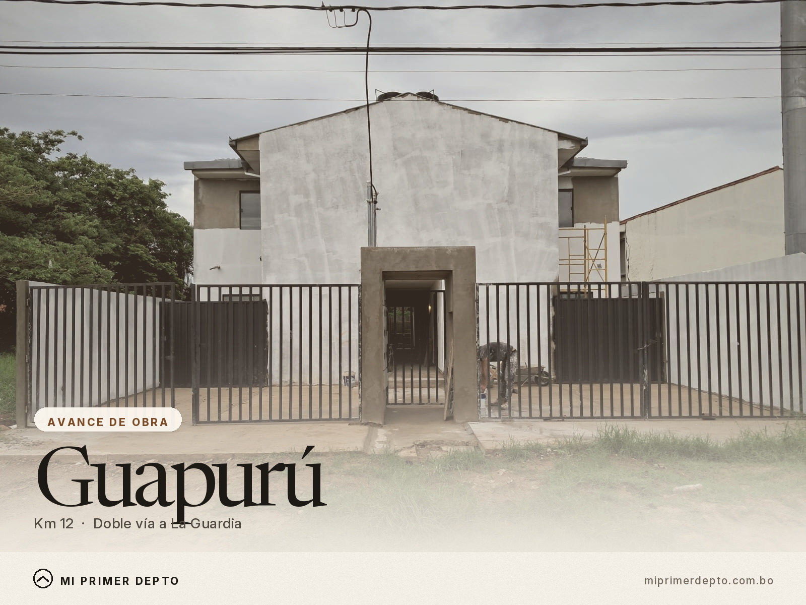
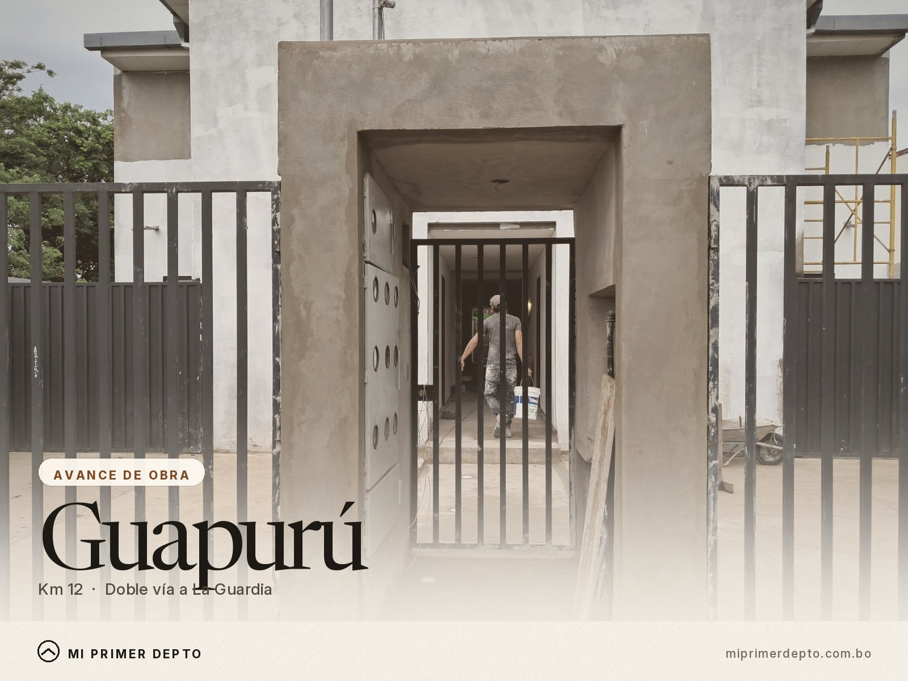
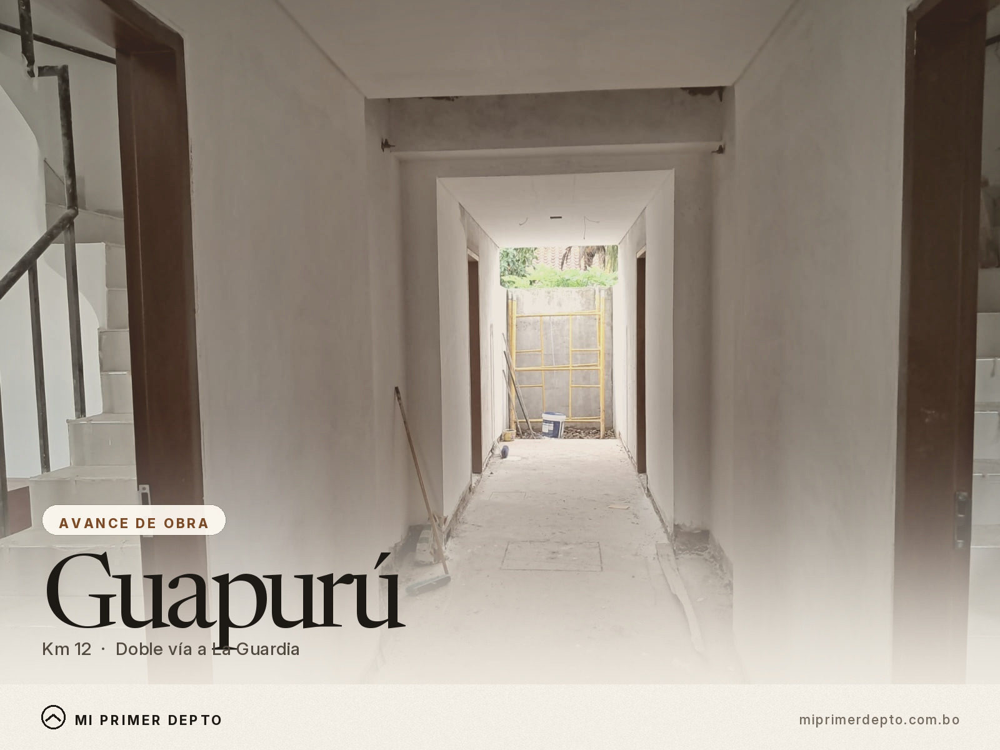
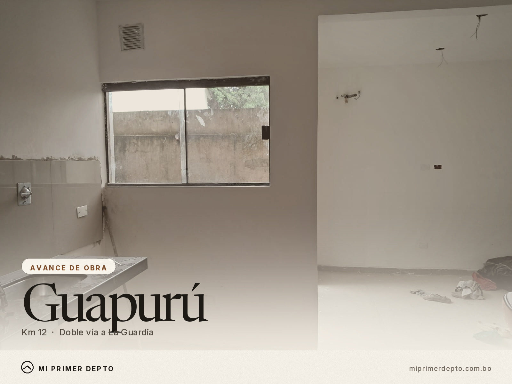
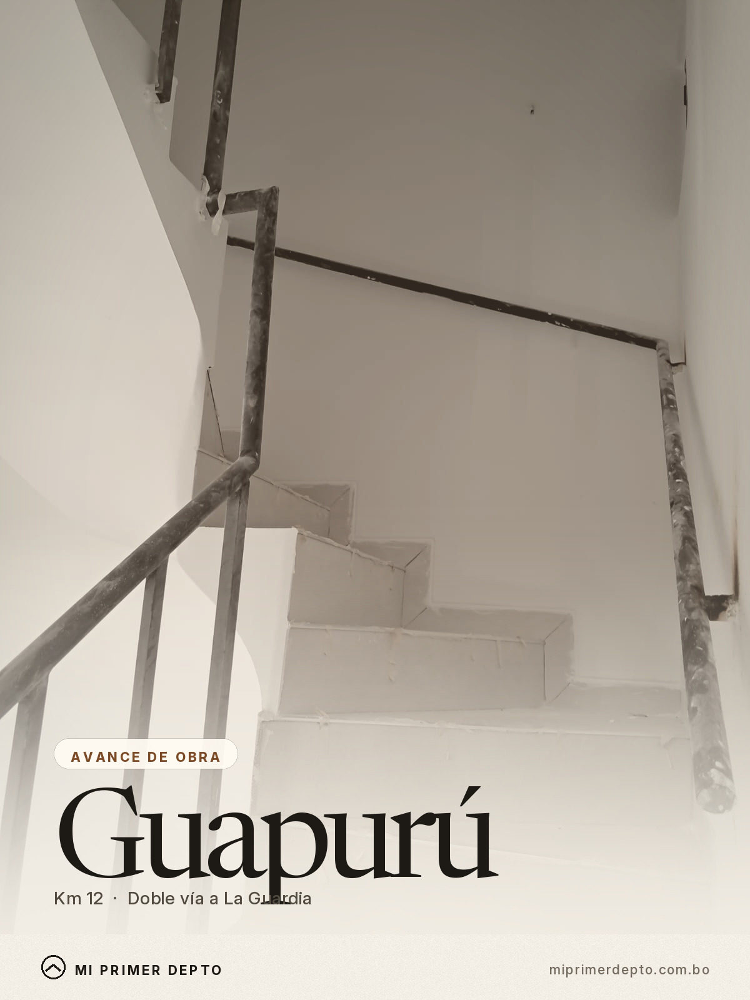
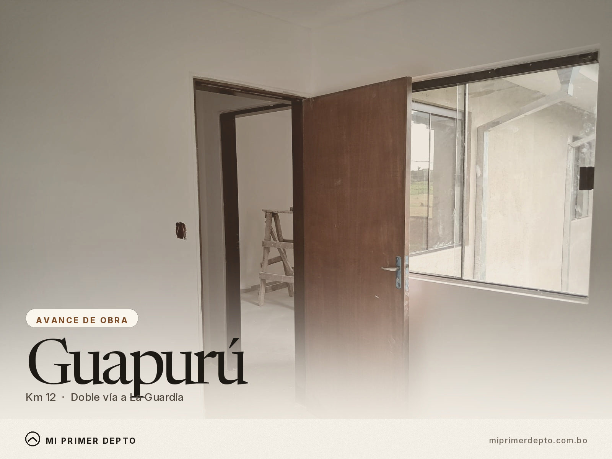

En noviembre de 2026 se puede ver el avance de obra de un departamento en Santa Cruz hacia La Guardia: la fachada, el ingreso, el pasillo, la planta baja, la escalera y un dormitorio. Todavía es obra en curso.

Las fotos son del Condominio Guapurú, en el Km 12 de la Doble vía a La Guardia, en el municipio de La Guardia. Son [dúplex](/blog/que-es-un-duplex-en-santa-cruz/) de dos plantas, con patio propio. Hay 0 expensas mensuales. Solo en caso de gastos extraordinarios. La entrega es llave en mano, a un mes de la reserva.

Cada dúplex tiene patio, tanque de agua exclusivo, gas natural y preinstalación de aire acondicionado en todos los ambientes. También tiene desagüe para la lavadora, con un recolector de aguas jabonosas y cámaras filtrantes.

## Fachada

La primera foto es la fachada. Se ve el volumen de dos plantas, la reja negra y el ingreso al centro. Hay un trabajador junto al portón. El revoque y la pintura siguen en proceso. No es un render.

<figure class="note-cover">
  <picture>
    <source type="image/webp" srcset="/assets/images/blog/avance-de-obra-noviembre-2026-fachada.webp">
    
  </picture>
  <figcaption>Fachada de Condominio Guapurú en noviembre de 2026.</figcaption>
</figure>

## Ingreso

Pasás el portón y queda el ingreso: un portal de hormigón, la reja interior y el corredor hacia adentro. La obra está activa.

<figure class="note-cover">
  <picture>
    <source type="image/webp" srcset="/assets/images/blog/avance-de-obra-noviembre-2026-ingreso.webp">
    
  </picture>
  <figcaption>El ingreso, con la obra en marcha.</figcaption>
</figure>

## Pasillo

El pasillo cruza y abre hacia el fondo, al aire. Se ve un muro, un andamio y vegetación atrás. A los costados están los huecos de las puertas. Hay herramientas en el piso. Todavía no está terminado: es el recorrido de la unidad, en obra.

<figure class="note-cover">
  <picture>
    <source type="image/webp" srcset="/assets/images/blog/avance-de-obra-noviembre-2026-pasillo.webp">
    
  </picture>
  <figcaption>El pasillo, hacia el fondo de la unidad.</figcaption>
</figure>

## Planta baja

Abajo está el día. En esta foto se ve la kitchenette, con mesada y pileta bajo una ventana, y la abertura al ambiente de estar. Falta terminación, pero ya se lee el uso: cocinar, estar, mirar afuera.

<figure class="note-cover">
  <picture>
    <source type="image/webp" srcset="/assets/images/blog/avance-de-obra-noviembre-2026-planta-baja.webp">
    
  </picture>
  <figcaption>La planta baja: kitchenette, ventana y el ambiente de estar.</figcaption>
</figure>

## Escalera

La escalera es de la unidad. Sube con baranda metálica, todavía sin la terminación final. En un [dúplex](/blog/que-es-un-duplex-en-santa-cruz/), esa escalera separa el día de abajo de los dormitorios de arriba.

<figure class="note-cover is-portrait">
  <picture>
    <source type="image/webp" srcset="/assets/images/blog/avance-de-obra-noviembre-2026-escalera.webp">
    
  </picture>
  <figcaption>La escalera que une las dos plantas.</figcaption>
</figure>

## Dormitorio

Arriba, un dormitorio con ventana hacia afuera y la puerta de madera abierta hacia el otro ambiente. Hay un caballete: se sigue trabajando. Es una habitación en obra, no una foto de catálogo.

<figure class="note-cover">
  <picture>
    <source type="image/webp" srcset="/assets/images/blog/avance-de-obra-noviembre-2026-dormitorio.webp">
    
  </picture>
  <figcaption>Un dormitorio, todavía en obra.</figcaption>
</figure>

Esto no es un depto entregado. Es el avance de noviembre. El km 12 es La Guardia, no Santa Cruz de la Sierra. En la misma Doble vía, más hacia la ciudad, está [Ventura Sur, en el 5to anillo](/blog/ventura-sur-5to-anillo-doble-via-la-guardia/). No está al lado. Queda en el camino.

Si querés conocer los dúplex, escribinos y pedí el dossier. Fijate plantas, patio y disponibilidad.
